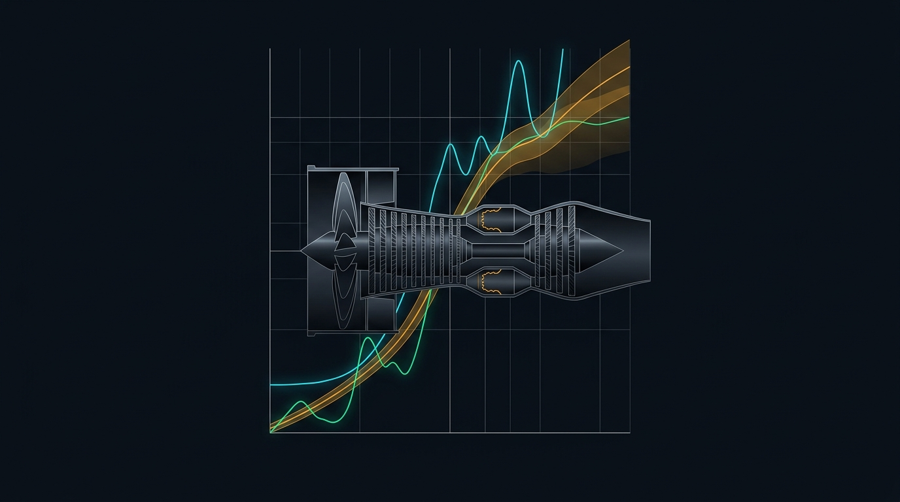

<div align="center">
  

  <h1>ForgeMind AI</h1>
  <p><strong>Uncertainty-Aware Predictive Maintenance &amp; Decision Simulation Workbench</strong></p>

  <p>
    
    
    
    
    
    
  </p>

  <p>
    <a href="#workbench-modules">Workbench Modules</a> •
    <a href="#pipeline-architecture">Architecture</a> •
    <a href="#scientific-transparency--data-provenance">Data Provenance</a> •
    <a href="#local-development--verification">Quick Start</a> •
    <a href="#vercel-deployment">Deploy on Vercel</a>
  </p>
</div>

<p align="center">
  
</p>

---

## Core Engineering Question

> **How can predictive maintenance incorporate uncertainty when estimating Remaining Useful Life (RUL) and selecting preventive maintenance policies?**

Point RUL forecasts alone ignore multi-regime sensor variance and asymmetric unplanned failure penalties ($C_f \gg C_p$). **ForgeMind AI** couples engine-disjoint RUL surrogate predictions with **finite-sample split conformal prediction intervals** so maintenance policies act on calibrated lower confidence bounds ($\max(0, \hat{y} - \hat{q}_{\text{bin}}) \le \tau$) rather than optimistic point estimates.

---

## Scientific Transparency & Data Provenance

> **Non-Operational Research Prototype Notice**
> ForgeMind AI is an academic and methodological simulation workbench. It is **not** a certified aviation, industrial safety, or operational maintenance decision system and must not be used to authorize equipment dispatch, inspection intervals, or safety-critical maintenance actions.

| Component | What Runs in the Browser | Scientific Boundaries |
| --- | --- | --- |
| **Telemetry & Datasets** | Deterministic `mulberry32` seeded synthetic C-MAPSS-shaped turbofan fleets (**48 units/subset**, 21 channels `s1–s21`, operating settings `OS1–OS3`). | Does **not** load raw NASA C-MAPSS `.txt` files; NASA `FD001–FD004` specs are shown strictly as literature reference metadata. |
| **Model Estimators** | In-browser TypeScript **model-family surrogates** (*Ridge Linear*, *Random Forest*, *Histogram GBDT*, *Causal Sequence ELM*). | Evaluates comparative inductive biases on synthetic splits; does **not** train offline PyTorch, TensorFlow, or scikit-learn weights. |
| **Conformal Intervals** | Genuine finite-sample split conformal quantile calibration ($\lceil (n+1)(1-\alpha) \rceil / n$) globally and across RUL horizon bins `[0–30, 31–60, 61–90, 91+]`. | Coverage guarantees assume exchangeability between calibration and evaluation unit residuals. |
| **Decision Economics** | Genuine cycle-by-cycle episode replay across 5 policies (*Run-to-Failure*, *Fixed Interval*, *RUL Threshold*, *Risk-Aware Conformal*, *Oracle*) with 350-resample unit bootstrap 95% CIs. | Single-asset $C_p / C_f$ cost model; discrete 10% failure-rate steps reflect the 10-unit blind evaluation cohort. |
| **External Artifacts** | Schema-validated JSON artifact import/export & 3-page `jsPDF` audit reports with explicit provenance tags (`synthetic_demo` vs. `imported_file`). | Imported artifacts update summary metrics/provenance badges while keeping interactive fleet charts explicitly labeled as local synthetic simulations. |

---

## Workbench Modules

ForgeMind AI includes **10 coupled analytical views** plus a **Guided Interactive Tour** and **3 Reviewer Scenarios**:

1. **Mission Overview** — Engineering problem framing, live KPI snapshot, 3 one-click investigation scenarios, interactive architecture diagram, provenance/limitations audit, and institutional attribution.
2. **Dataset Explorer** — `FD001–FD004` regime profiles, operating condition distributions (`OS1–OS3`), engine-disjoint split counts, and sensor degradation envelopes.
3. **Fleet Health Overview** — 48-unit fleet matrix, **Fleet Stress Scatter Plot** (current RUL vs. operational cycles color-coded by conformal uncertainty width to flag high-risk/high-uncertainty engines), and sparkline triage.
4. **Machine Health** — Cycle-by-cycle engine playback with **RUL Volatility** rolling standard-deviation metric & instability alerts, conformal prediction band overlay, and 10-point OLS EOL projection.
5. **Feature Analytics** — Fit-only 12-iteration $k$-means operating-regime clustering, per-regime min-max scaling vs. global normalization comparisons, and causal trailing window diagnostics.
6. **Model Benchmark** — Surrogate model-family comparisons on MAE, RMSE, asymmetric **PHM08 Score**, and downstream maintenance cost A/B comparisons.
7. **Robustness & Conformal** — Empirical coverage vs. nominal $(1 - \alpha)$ calibration diagnostics, horizon-binned interval widths $\hat{q}$, and conformal uncertainty outlier analysis.
8. **Decision Simulator** — Interactive preventive cost ($C_p$), unplanned failure cost ($C_f$), significance level ($\alpha$), and trigger threshold ($\tau$) tuning with 95% bootstrap CIs and cumulative ROI curves.
9. **Sensitivity Analysis** — D3 2D cost-per-cycle heatmaps across $(C_p, \tau)$ and a rotatable **3D Maintenance Cost Surface** (`D3.js` projection) isolating the minimum-cost operating basin.
10. **Research & Repro** — Provenance ledger, mathematical formulations, YAML seed specs, schema-validated JSON import/export, 3-page PDF report generator, and LinkedIn showcase card/BibTeX export.

---

## Pipeline Architecture

Every subset enforces **strict unit-ID separation** (zero cross-unit data leakage):

```text
Synthetic Fleet (48 units/subset, seeded mulberry32)
  ├── 45% Fit Cohort (22 units)       ──▶ Regime k-means, per-regime scalers & RUL surrogates
  ├── 20% Calibration Cohort (9 units)──▶ Split conformal residual quantiles q̂ (global & RUL-binned)
  ├── 15% Policy Tuning Cohort (7 u.) ──▶ Threshold τ & risk-multiplier parameter search
  └── 20% Evaluation Cohort (10 units)──▶ Blind PHM08 scoring, empirical coverage & episode cost replay
```

---

## Tech Stack

- **Frontend:** React 19, TypeScript, Vite 8, Tailwind CSS v4
- **Visualization:** D3.js v7 (2D heatmaps & 3D cost surfaces) + custom responsive SVG telemetry charts
- **Simulation Kernel:** Pure TypeScript numerical modules (`src/engine/*`) with deterministic seeded PRNG (`mulberry32`)
- **Reporting & Exports:** `jsPDF` 3-page technical report builder, HTML5 Canvas social card export, schema-validated JSON artifacts
- **Testing:** Built-in Node.js test runner (`node:test` via `tsx`) — **32 unit & invariant tests**

---

## Local Development & Verification

### Prerequisites
- Node.js `>= 20` and `npm` (or `bun`)

### Install & Run
```bash
npm install
npm run dev
```
Open `http://localhost:3000`.

### Run Typechecks, Unit Tests & Production Build
```bash
# TypeScript static check
npm run lint

# Run all 32 deterministic simulation, conformal, leakage & metric tests
npx --yes tsx --test src/engine/engine.test.ts

# Build production bundle into dist/
npm run build
```

---

## Vercel Deployment

The repository includes [`vercel.json`](vercel.json) preconfigured for Vite (`npm run build` → `dist/` with SPA fallback rewrites):

1. Push this repository to GitHub.
2. Import the repository in [Vercel](https://vercel.com/new).
3. Keep the detected **Vite** preset (`Build Command: npm run build`, `Output Directory: dist`) and click **Deploy**.

---

## Author & Citation

**MD Ibtashamur Rahman**  
Department of Industrial and Production Engineering  
Shahjalal University of Science and Technology (SUST), Bangladesh  

```bibtex
@software{rahman2026forgemind,
  author  = {Rahman, MD Ibtashamur},
  title   = {ForgeMind AI: Uncertainty-Aware Predictive Maintenance Research Platform},
  version = {1.1.0},
  year    = {2026},
  url     = {https://github.com/Ibtasham/ForgeMind-Ai},
  license = {MIT}
}
```

Released under the [MIT License](https://opensource.org/licenses/MIT).
